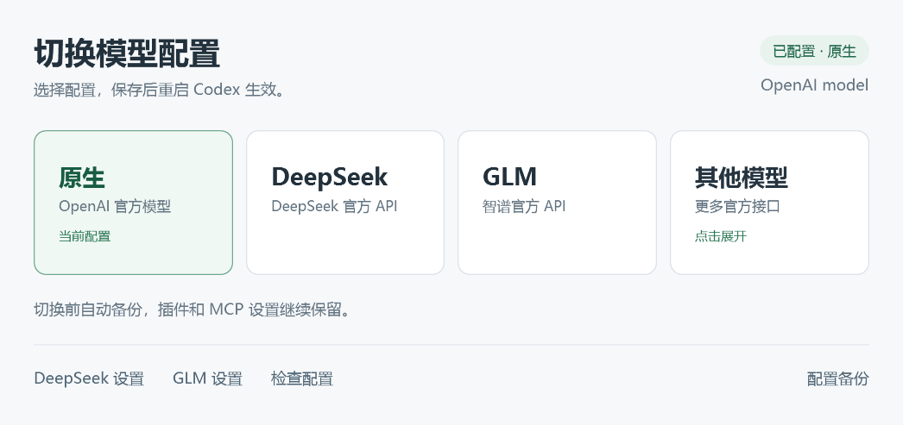
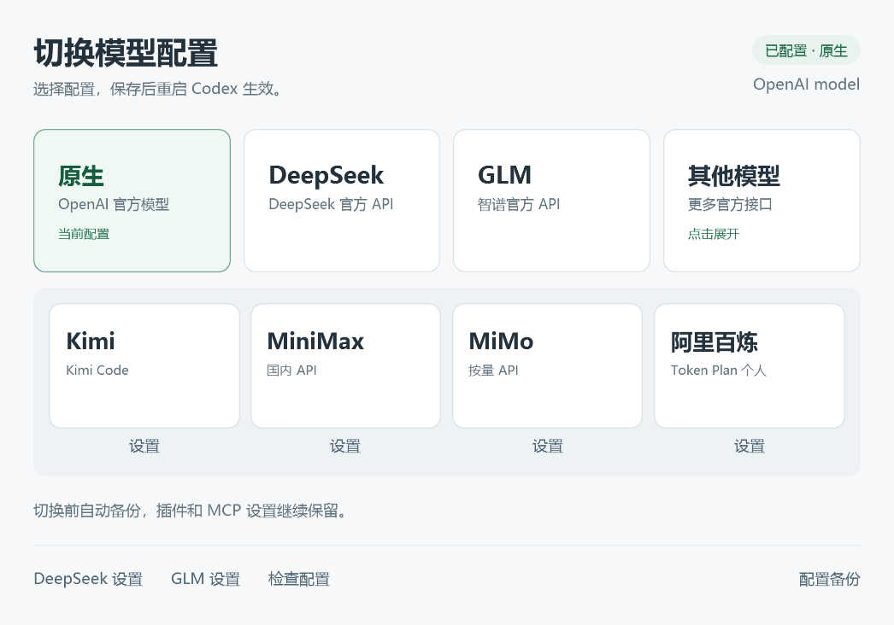

# Codex Config Switcher

Windows 上的 Codex 配置切换器：主界面提供 **OpenAI 原生、DeepSeek、GLM、其他模型** 四个按钮，保存后重启 Codex 生效。

这是社区工具，与各模型厂商没有隶属关系。程序直连厂商官方 API，不使用中转服务。



## 下载与使用

1. 从 [Releases](https://github.com/Salvation7/codex-config-switcher/releases) 下载 Windows ZIP，解压到一个长期保留、当前用户可写的文件夹。请保留全部文件。
2. 确认已安装官方 Codex，且首次启动切换器时 Codex 配置处于 **OpenAI 原生模式**，用于保存准确的原生设置。
3. 双击 `CodexConfigSwitcher.exe`。首次使用第三方提供商时，在对应设置窗口填写自己的 API Key。点击“其他模型”会在下一行展开 Kimi、MiniMax、MiMo、阿里百炼，再点一次收起。
4. 点击目标配置按钮，然后完全退出并重新打开 Codex。

支持 Windows 10/11 x64，需要系统自带的 Windows PowerShell 5.1 和 .NET Framework 4.8 或更高版本。配置校验使用已安装的 Codex CLI，可从 PATH 或官方桌面应用安装目录查找。

可选：在程序文件夹运行以下命令，建立桌面快捷方式：

```powershell
powershell.exe -NoProfile -ExecutionPolicy Bypass -File .\Install-Switcher.ps1 -DesktopShortcut
```

## 功能

- WPF 界面，支持逐显示器高 DPI 缩放、ClearType 文字和像素对齐。
- 保留原生模型选择；第三方模式使用各自的官方模型目录。
- 保留当前插件、MCP、通知和项目权限设置。
- 每次实际修改前备份配置，写入前调用 Codex 自身解析器验证。
- 使用原子替换和并发修改检测，避免覆盖刚被其他程序更新的配置。
- 不读取或修改 `auth.json`，不自动结束 Codex，不迁移聊天数据库。

## v2.2 新增提供商



仅增加有官方 Codex Responses 配置和可复用官方模型目录的入口，复用已有保存、校验、备份和恢复流程。没有增加 API 中转、协议转换或兼容旧协议的分支。

| 入口 | 支持范围 | 默认模型 |
| --- | --- | --- |
| Kimi | Kimi Code 专用 API Key，需有对应 Coding 额度 | `k3-256k` |
| MiniMax | 国内站 API Key；当前目录仅包含官方教程提供的模型 | `MiniMax-M3.1-Flash-Preview` |
| MiMo | 按量 API Key；不适用于 Token Plan 订阅 Key | `mimo-v2.6-pro` |
| 阿里百炼 | Token Plan 个人版专用 API Key；不适用于旧 Coding Plan、团队版或普通按量 API | `auto` |

设置窗口固定使用各入口的官方 API 地址，并限制选择对应官方目录中的模型及思考强度。厂商名称相同不代表不同套餐的 Key、地址或模型可以混用。v2.2 暂不加入需要额外适配的其他入口。

从 v2.1 升级时，用发布包中的程序文件覆盖原程序文件夹，保留自己的 `state.json`。新增的模型选择会在正常保存或切换时加入原有状态文件，原生设置快照继续沿用。

## 密钥与本地数据

仓库和下载包不含预置 API Key、账号登录、个人配置、备份或状态文件。

首次运行会在程序目录生成 `state.json`，保存本机原生设置和模型选择。它绑定对应的配置目录，不能拿其他人的状态文件覆盖本机状态。这个文件可能包含本机路径或原生自定义配置，请不要上传。

填写的 API Key 保存在本机 Codex provider 配置中。配置备份位于 Codex 配置目录下的 `config-switcher-backups`，也可能含密钥。`.gitignore` 已排除常见本地状态、登录和备份文件，但不应将真实配置拷贝进源码目录。

## 切换范围

这是启动配置切换器。已打开的聊天不会即时切换厂商，已有聊天可能保留原来的 provider 绑定；跨厂商工作建议在重启后新建聊天。

第三方配置默认保留原生 ChatGPT 登录。DeepSeek 和 MiniMax 教程中的 `forced_login_method = "api"` 有意省略，以免切换时强制退出已有登录。按对应入口的官方协议、地址和模型目录配置，密钥沿用切换器现有的本地保存方式。六家模型目录的来源与哈希记录在 `official-sources.json`，新增四家的固定配置记录在 `providers.json`。

切回原生时恢复受切换影响的模型、认证偏好、上下文参数和桌面思考档位。插件启用不代表第三方模型一定支持对应工具；浏览器、Computer Use、多代理等功能仍受 Codex 和厂商接口能力限制。

## 从源码构建

```powershell
powershell.exe -NoProfile -ExecutionPolicy Bypass -File .\Build-Switcher.ps1
```

构建使用 Windows 自带的 .NET Framework C# 编译器，不下载依赖。EXE 将 Windows PowerShell 5.1 托管在声明了高 DPI 支持的进程中。

## 验证

```powershell
# 隔离的配置回归测试；需要已安装 Codex，不发送模型 API 请求。
powershell.exe -NoProfile -ExecutionPolicy Bypass -File .\Test-Switcher.ps1

# 界面渲染检查：会读取本机配置，并可能在首次运行时生成本机 state.json。
.\CodexConfigSwitcher.exe --smoke-test
```

发布前完成了 34 项隔离配置回归测试，以及七个配置按钮、展开/收起、六家设置保存、原生恢复和 100% / 125% / 150% / 200% DPI 界面的隔离检查。新增四家的官方目录也通过了 Codex 内核的模型列表加载校验。测试不发送真实模型请求，不能替代厂商服务可用性或账号额度检查。测试中的 `TEST_*` 字符串均为固定虚构值。

## 官方配置参考

- [OpenAI 自定义模型提供商](https://learn.chatgpt.com/docs/config-file/config-advanced#custom-model-providers)
- [OpenAI 登录方式设置](https://learn.chatgpt.com/docs/auth#enforce-a-login-method-or-workspace)
- [智谱 Codex 接入](https://docs.bigmodel.cn/cn/coding-plan/tool/codex)
- [DeepSeek Codex 接入](https://api-docs.deepseek.com/zh-cn/quick_start/agent_integrations/codex/)
- [Kimi Code Codex 接入](https://www.kimi.com/code/docs/third-party-tools/codex.html)
- [MiniMax 国内站 Codex 接入](https://platform.minimax.cn/docs/m-plan/codex)
- [MiMo Codex 配置](https://mimo.mi.com/docs/zh-CN/tokenplan/integration/codex-configuration)
- [阿里百炼 Codex 接入](https://help.aliyun.com/zh/model-studio/codex)

官方模型元数据属于各自来源；接口、模型名称和桌面兼容性可能随厂商更新而变化。
